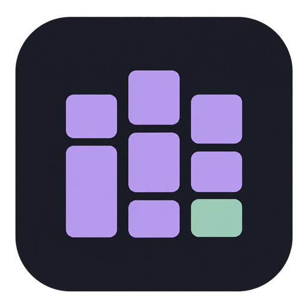

<p align="center">
  
</p>

<h1 align="center">Atelier Kanban</h1>

<p align="center">A local workspace for tasks, coding agents, Git reviews and time tracking.</p>

<p align="center">
  <a href="Cargo.toml"></a>
  <a href="LICENSE"></a>
  <a href="rust-toolchain.toml"></a>
  
</p>

<p align="center">
  <a href="https://github.com/FluryWaana/atelier/actions/workflows/rust.yml"></a>
  <a href="https://github.com/FluryWaana/atelier/actions/workflows/prerelease.yml"></a>
  <a href="https://github.com/FluryWaana/atelier/actions/workflows/unix-prerelease.yml"></a>
</p>

Atelier Kanban brings planning and implementation into one workspace on your computer. Organize tasks, prepare a Git worktree, run a coding agent, inspect its changes and record your own time. Your tasks and time tracking work locally without an external account.

The native Rust application stores workspace data in SQLite and serves a Leptos interface in your browser. Credentials use the operating system credential store. The application and its build do not require Node.js.

## Features

* Organize projects and tasks with a Kanban board, criteria, dependencies, search and archives.
* Work with Codex, Claude Code or a custom command through profiles, conversations and an execution queue.
* Prepare dedicated Git worktrees, browse files and diffs, create commits and review changes before publication.
* Connect Jira, Tempo, GitHub, GitLab, Azure DevOps or compatible process connectors.
* Track human time separately from agent activity, export reports and prepare confirmed remote time exports.
* Manage backups, restore workspace data and inspect application updates.

The interface is available in English and French. See the [feature guide](docs/features.md) for behavior and limits.

## Get started

Find published packages and their release notes on [GitHub Releases](https://github.com/FluryWaana/atelier/releases). The version badge identifies the source tree. Package availability depends on the release and platform. Atelier Kanban is in preproduction.

To run from source, install the toolchain from [rust-toolchain.toml](rust-toolchain.toml), Git, Trunk 0.22.1 and wasm-bindgen CLI 0.2.130. Then run:

```sh
cargo fetch --locked
cargo xtask build-ui
cargo build -p atelier-app --locked
cargo run -p atelier-app --locked -- launch --data-dir .artifacts/quickstart/data --assets .artifacts/rust-ui --port 4317
```

Use the browser session opened by the application. Stop it with `cargo run -p atelier-app --locked -- stop --data-dir .artifacts/quickstart/data --port 4317`. On Windows, [Atelier.cmd](Atelier.cmd) provides a development preview with automatic rebuilding.

See [getting started](docs/getting-started.md) for platform requirements, first use and launch options.

## Documentation

* [Documentation index](docs/README.md)
* [Features](docs/features.md)
* [Architecture](docs/architecture.md)
* [Development and contribution](CONTRIBUTING.md)
* [Verification](docs/rust-final-qualification.md)
* [Packaging and updates](docs/rust-packages.md)
* [Brand assets](docs/branding.md)

## Contribute

Bug reports and focused pull requests are welcome on [GitHub](https://github.com/FluryWaana/atelier). Include reproduction steps and use synthetic data for examples. Read [CONTRIBUTING.md](CONTRIBUTING.md) before changing the code or running integration checks.

## License

Atelier Kanban is licensed under [AGPL 3.0 or later](LICENSE). Distribution includes dependency notices generated from the locked Rust packages and documented [license supplements](xtask/licenses/README.md).
